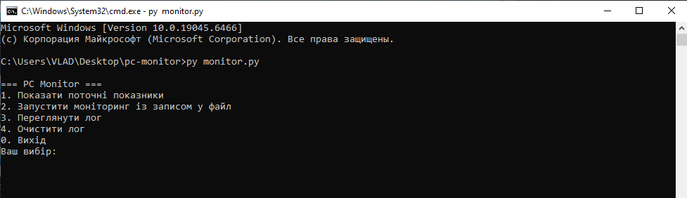
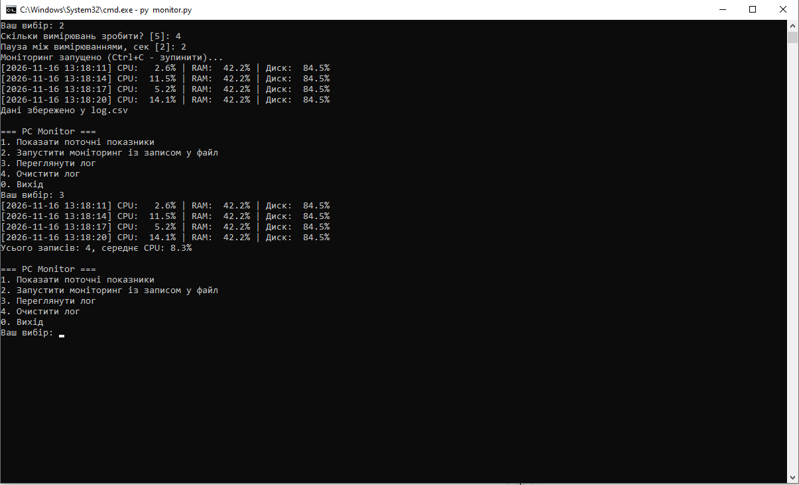
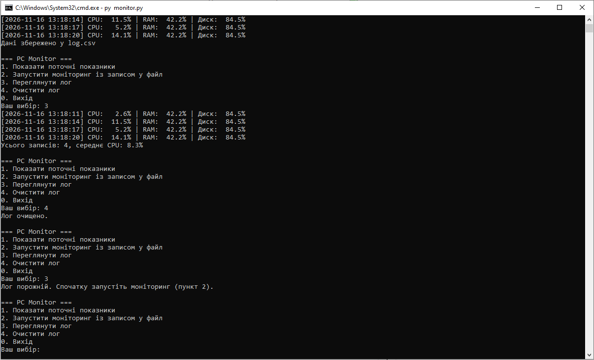

# PC Monitor
 
## 1. Опис проєкту
 
**PC Monitor** - це консольний застосунок на Python, який стежить за станом комп'ютера.
Він показує завантаження **процесора (CPU)**, **оперативної пам'яті (RAM)** та **диска**
у відсотках і зберігає історію вимірювань у файл `log.csv`, який можна відкрити в Excel.
 
Програма вирішує просту інженерну задачу: швидко побачити, наскільки навантажений
комп'ютер, і зберегти дані для подальшого аналізу.
 
## 2. Порядок роботи
 
1. Користувач запускає програму та бачить текстове меню.
2. Обирає потрібну дію, вводячи цифру.
3. Програма за допомогою бібліотеки `psutil` зчитує поточні показники системи.
4. Показники виводяться на екран, а під час моніторингу ще й дописуються у `log.csv`.
5. Збережену історію можна переглянути (останні 10 записів і середнє CPU) або очистити.
Схема:
 
```
Запуск -> Меню -> вибір пункту
                    |-- 1: зчитати показники -> вивести на екран
                    |-- 2: цикл вимірювань   -> вивести на екран + записати в log.csv
                    |-- 3: прочитати log.csv -> вивести записи та середнє CPU
                    |-- 4: видалити log.csv
                    `-- 0: вихід
```
 
Програма перевіряє ввід користувача: при введенні букв, від'ємних чисел
або неіснуючого пункту меню вона виводить повідомлення про помилку і не завершується аварійно.
 
## 3. Інструкція з запуску
 
Потрібен встановлений Python 3.8 або новіший.
 
1. Завантажте проєкт (кнопка **Code -> Download ZIP**) і розпакуйте архів.
2. Відкрийте консоль (`cmd`) у папці проєкту.
3. Встановіть залежності:
```
pip install -r requirements.txt
```
4. Запустіть програму:
```
python monitor.py
```
 
Якщо на Windows команда `python` нічого не робить, використайте `py monitor.py`.
 
## 4. Огляд працездатності
 
### Головне меню

 
### Моніторинг із записом у файл

 
### Перегляд логу та обробка помилок

 
## Структура проєкту
 
```
pc-monitor/
├── monitor.py        # код програми
├── requirements.txt  # залежності (psutil)
├── README.md
├── .gitignore
└── screenshots/      # скріншоти роботи
```
 
## Автор
 
Довбешко Владислав Андрійович, група М-КІ-52
